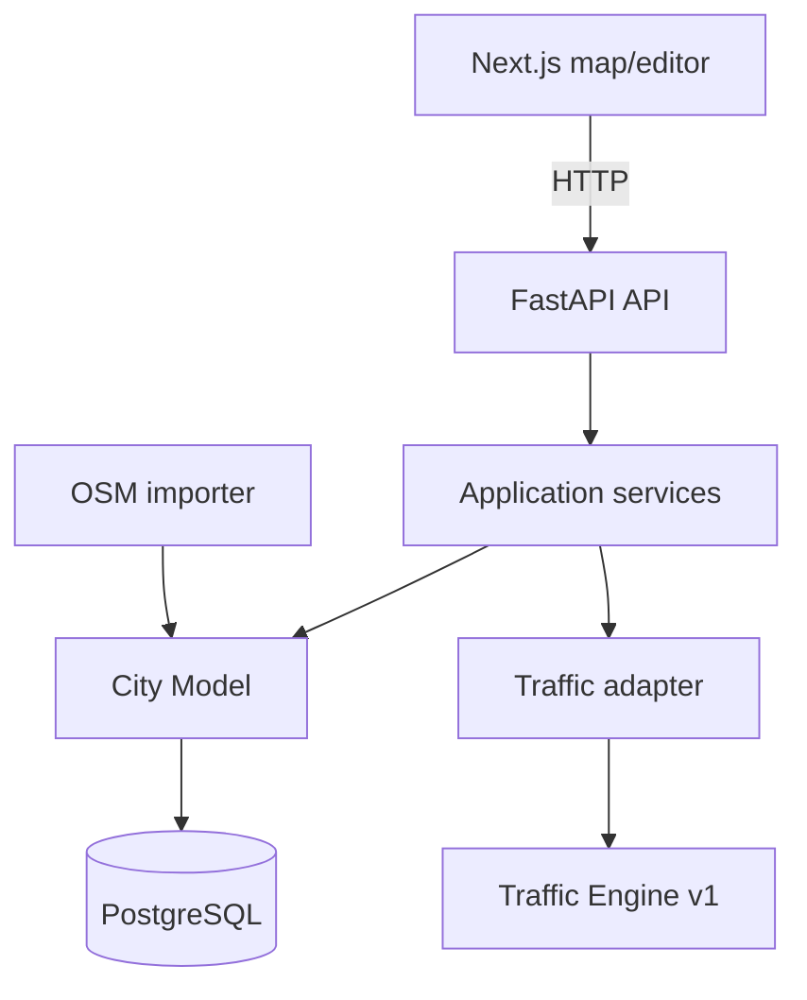

# Pixel Lane

Pixel Lane is an early-stage smart-city and urban traffic-management platform for modelling road networks, inspecting infrastructure, and running static traffic analysis. Its persistent City Model, map/editor workflow, and simulation-ready boundaries support future municipal traffic-engineering work without claiming live control features today.

**Long-term direction.** Pixel Lane's target is a transport digital-twin platform for government/city administration: model a real network, simulate proposed changes before building them, and compare measured Before/After outcomes, working toward network-wide adaptive signal control and (eventually, under human supervision) live control. See [docs/product/vision.md](docs/product/vision.md) for the full vision and non-goals, and [docs/roadmap.md](docs/roadmap.md) for what's implemented today versus planned. Nothing in this section describes a current capability — see the status table below for that.

## Status

| Capability | Status |
| --- | --- |
| City Model v1 / PostgreSQL | Implemented |
| Traffic Engine v1 static analysis | Implemented |
| Almaty OSM import | Implemented |
| MapLibre map and limited road geometry editing | Implemented |
| Map congestion overlay | Pending |
| SUMO, adaptive signals, advanced editing | Planned |

## What it does today

- Stores cities, roads, lanes, intersections, traffic lights, rules, parking, and demand in PostgreSQL.
- Runs framework-independent static routing, capacity, congestion, and bottleneck analysis.
- Imports a bounded real OpenStreetMap road-network sample for central Almaty.
- Renders the City Model in MapLibre; Terra Draw temporarily edits an existing road polyline before the backend persists it.

## Architecture



The City Model is authoritative. MapLibre GeoJSON, basemaps, and Terra Draw state are presentation/editing infrastructure only. See [architecture](docs/architecture.md).

## Quick start

Prerequisites: Docker Desktop, Make, Node.js 22+, and Python 3.11+ for local service work.

```bash
cp .env.example .env
# Set local development values; never commit .env.
make start
```

Open `http://localhost:3000`; API docs are at `http://localhost:8000/docs`. `make start` uses `docker compose up -d --build`, so it refreshes baked source rather than silently serving a stale image. Use `make status`, `make logs`, `make stop`, and `make help` for the lifecycle; `make reset` is destructive.

## Almaty demo

Install the isolated OSM extra in `backend/.venv`, then run `make start` and `make import-almaty`. The deterministic import is idempotent. OSM provides network attributes and signal presence, not demand volumes or signal timing. See [OSM import](docs/osm-import.md).

## Development and documentation

- [Documentation index](docs/README.md)
- [Product vision](docs/product/vision.md)
- [Roadmap](docs/roadmap.md)
- [Development guide](docs/development.md)
- [Configuration](docs/configuration.md)
- [Testing](docs/testing.md)
- [Contributing](CONTRIBUTING.md)

`AGENTS.md` is the authoritative project policy for contributors and AI agents. The project currently has no license file; do not assume reuse rights until one is added.
